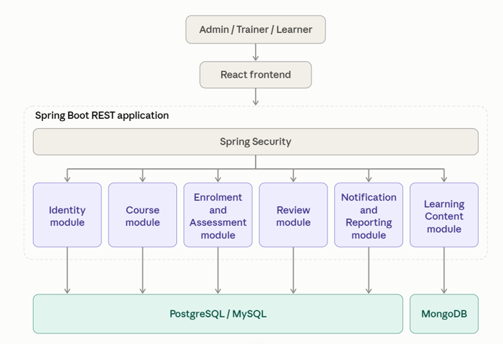

# Enterprise-Monolithic-Application
Learning Management System (LMS) with six independently developed functional modules, integrated into one deployable application.

# Learning and Training Management System

A corporate training web application for managing trainers, learners, courses, learning content, enrolments, assessments, reviews, and notifications.

**Recommended implementation:** Weeks 5–8  
**Final demo:** Week 8  
**Architecture:** Monolithic Spring Boot backend with six logical modules

## Table of Contents

- [Business Scenario](#business-scenario)
- [Team Modules](#team-modules)
- [Mandatory Functional Requirements](#mandatory-functional-requirements)
- [Technology and Data Requirements](#technology-and-data-requirements)
- [Monolithic Architecture](#monolithic-architecture)
- [Module Contracts and Integration Rules](#module-contracts-and-integration-rules)

## Business Scenario

A corporate training organization needs one web application to manage its training operations.

The system supports three primary roles:

| Role | Responsibilities |
| --- | --- |
| **Administrator** | Manages users, permissions, course approval, and reporting. |
| **Trainer** | Creates courses, publishes modules and learning resources, and manages assessments. |
| **Learner** | Discovers courses, enrols, studies content, submits assessments, and reviews completed courses. |

## Team Modules

| Module | Owner | Scope |
| --- | --- | --- |
| **1 — Identity, Users, and Roles** | Member 1 | Registration, login, user profiles, role-based access, account status, and access-controlled endpoints. Implement Spring Security with JWT or a suitable session-based approach. |
| **2 — Course and Curriculum Management** | Member 2 | Course catalogue, categories, trainer assignment, learning objectives, prerequisites, course lifecycle, and course search. Store structured course information in the relational database. |
| **3 — Learning Content and Delivery** | Member 3 | Modules, lessons, reading materials, links, attachment metadata, learner progress, and completion tracking. Store dynamic content metadata in MongoDB where appropriate. |
| **4 — Enrolment and Assessment** | Member 4 | Enrolment, assessment creation, question banks, submissions, scoring, completion status, and learner progress reports. |
| **5 — Reviews and Learner Feedback** | Member 5 | Ratings, written reviews, review moderation, course feedback, and course rating summaries. Enforce one review per eligible learner per course. |
| **6 — Notifications and Reporting** | Member 6 | In-app notifications, enrolment and assessment alerts, course completion summaries, and administrative dashboard reports. |

## Mandatory Functional Requirements

1. Users can log in and see role-appropriate navigation and operations.
2. Trainers can create, edit, publish, and archive courses.
3. Published courses contain ordered modules and lessons.
4. Learners can search the catalogue, enrol, access learning materials, and record progress.
5. Assessments can be submitted and scored, with attempts and results retained.
6. Learners can rate and review eligible courses.
7. Course and assessment events produce notifications.
8. Administrators can view course counts, enrolment summaries, and completion metrics.
9. All modules expose documented internal service interfaces and/or REST APIs, even though they run in one application.
10. Unauthorized access, invalid state transitions, and duplicate enrolments must be rejected.

## Technology and Data Requirements

| Layer | Required Technology | Responsibility |
| --- | --- | --- |
| **Frontend** | React, JavaScript or TypeScript | Routing, forms, dashboards, API calls, and state management. |
| **Backend** | Java and Spring Boot | REST APIs, validation, business logic, and security. |
| **Relational Data** | PostgreSQL or MySQL | Users, courses, enrolments, assessments, results, and reviews. |
| **Dynamic Data** | MongoDB | Flexible content metadata, notification payloads, and configurable question content where suitable. |
| **Persistence** | Spring Data JPA, Spring Data MongoDB, and JDBC where appropriate | Relational and document persistence. |
| **API Documentation** | OpenAPI / Swagger UI | Contract and endpoint documentation. |
| **Testing** | JUnit, Mockito, API integration tests, and React tests | Verification at each layer. |
| **Packaging** | Maven; Docker optional for P2 | Reproducible build and deployment. |

### Data Storage Principles

- Use the relational database for records that require strong relationships, constraints, and transactions.
- Use MongoDB only where the document structure genuinely benefits from flexibility.
- Do not duplicate the same source of truth in both databases.

## Monolithic Architecture

*Figure 6 — P2 monolithic LMS architecture.*

The React frontend communicates with a single Spring Boot REST application. Spring Security controls access to the six logical backend modules.

### Deployment Constraint

**P2 must use one backend application and one deployable backend artifact, with six logical modules.**

The application may use separate databases. Using multiple databases does not make it a microservices architecture.

## Module Contracts and Integration Rules

### Required Deliverables

Each team member must deliver:

- [ ] A defined scope and data ownership statement.
- [ ] REST endpoint specifications with request and response examples.
- [ ] DTOs and validation rules.
- [ ] Persistence implementation and migration scripts.
- [ ] Unit tests and integration tests.
- [ ] An API error model and logging.
- [ ] A short integration guide and demo dataset.

### Shared Conventions

Before implementation, the team must agree on:

| Convention | Agreement Required |
| --- | --- |
| **Shared Identifiers** | Consistent use of `userId`, `courseId`, and `enrolmentId`. |
| **Timestamps** | A shared timestamp format. |
| **Pagination** | Consistent pagination conventions. |
| **Error Responses** | A standard API error response format. |
| **API Naming** | Consistent endpoint and resource naming. |

**Shared DTOs should not expose JPA entities directly.**
